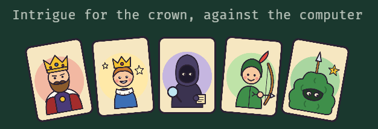

# Oriflamme

[](https://vr050714.github.io/oriflamme-rs/)


The Oriflamme card game (3–5 players) for one human against computer opponents, built with Rust and Bevy.

**[Play in the browser](https://vr050714.github.io/oriflame-rs/)**



## Run locally

```sh
cargo run
```

## License

[MIT](LICENSE)
